# Wazuh Windows Security Monitoring Lab

## Project Overview

This project demonstrates the use of Wazuh SIEM to monitor and analyze Windows security events. Multiple security-related activities were performed on a Windows 11 endpoint and successfully detected by Wazuh.

## Lab Environment

### Components

- Wazuh Server
- Wazuh Dashboard
- Windows 11 Endpoint
- Wazuh Agent

## Objectives

- Deploy and configure Wazuh
- Monitor Windows security events
- Generate and analyze security alerts
- Understand SOC analyst workflows
- Perform basic event investigation

---

## Events Monitored

### 1. Failed Login Attempt (Event ID 4625)

A failed authentication attempt caused by invalid credentials.

### 2. Successful Login (Event ID 4624)

A successful authentication event generated after valid credentials were provided.

### 3. Account Lockout (Event ID 4740)

A user account was locked after multiple failed login attempts.

### 4. User Account Creation (Event ID 4720)

A new local Windows user account was created.

### 5. User Added to Administrators Group (Event ID 4732)

A user account was granted administrative privileges.

### 6. Service Configuration Change (Event ID 7040)

The startup configuration of a Windows service was modified.

### 7. System Restart Event (Event ID 1074)

A system restart was initiated and logged by Windows.

---

## Event Analysis Summary

| Event ID | Event Name | Severity |
|-----------|------------|----------|
| 4625 | Failed Login Attempt | Medium |
| 4624 | Successful Login | Informational |
| 4740 | Account Lockout | Medium |
| 4720 | User Account Creation | Medium |
| 4732 | User Added to Administrators Group | High |
| 7040 | Service Configuration Change | Medium |
| 1074 | System Restart | Low |

---

## Skills Demonstrated

- SIEM Monitoring
- Wazuh Administration
- Windows Event Log Analysis
- Alert Investigation
- Security Monitoring
- Account Activity Monitoring
- Privilege Change Detection
- Security Documentation

---

## Screenshots

The screenshots folder contains alerts captured from the Wazuh dashboard during testing.

## Screenshots

### Failed Login Alert (Event ID 4625)

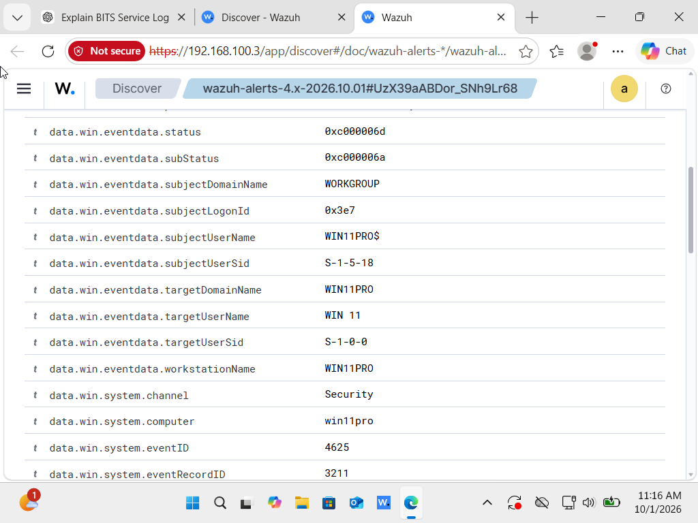

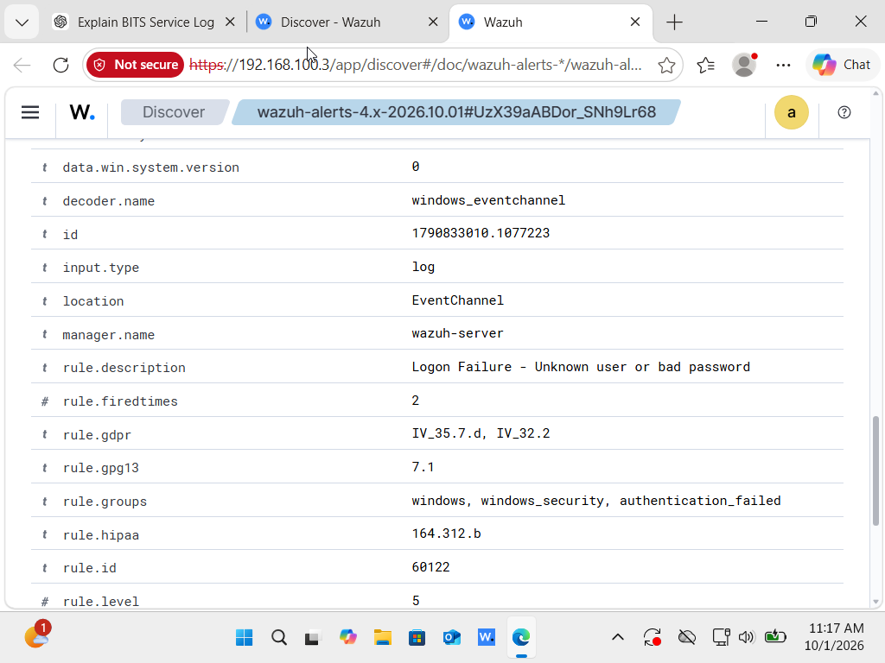

---

### Successful Login Alert (Event ID 4624)

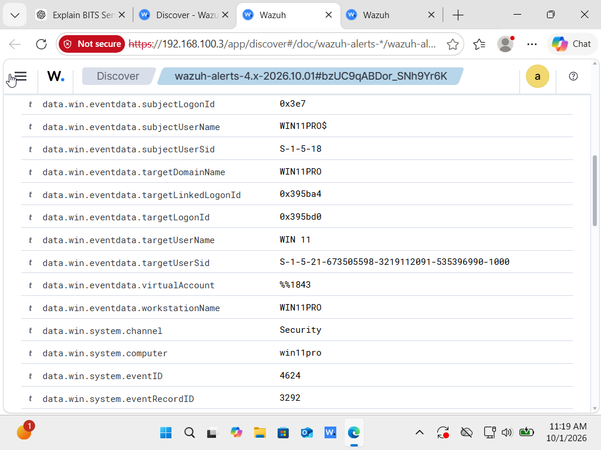

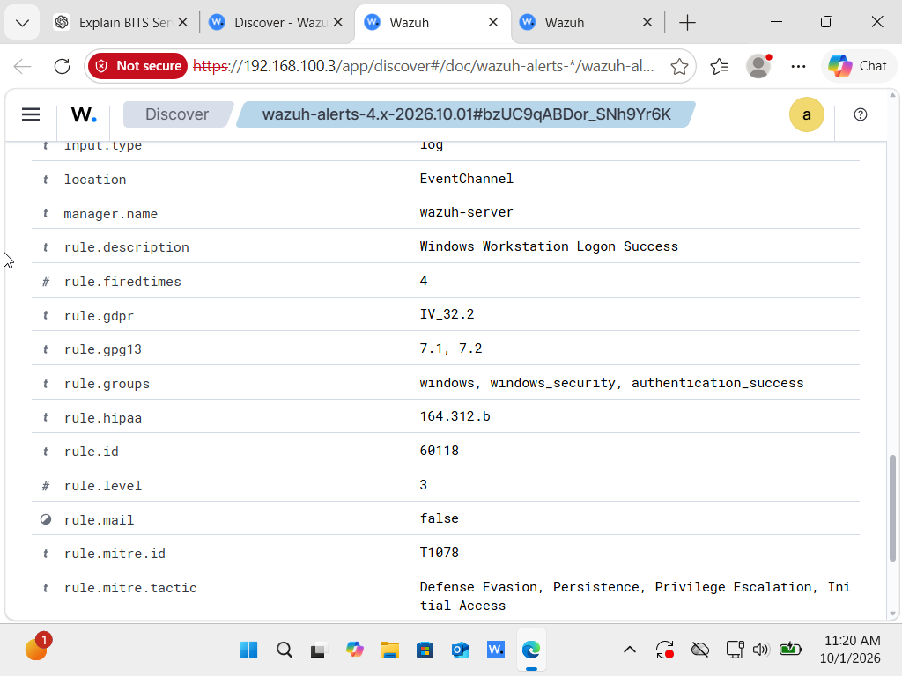

---

### Account Lockout Alert (Event ID 4740)

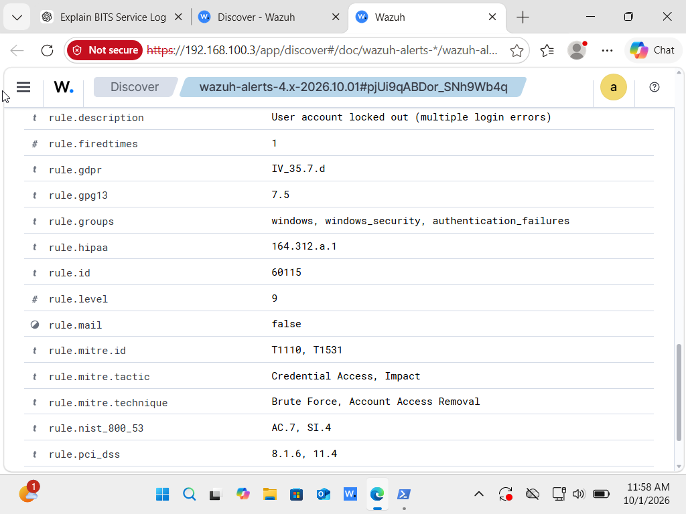

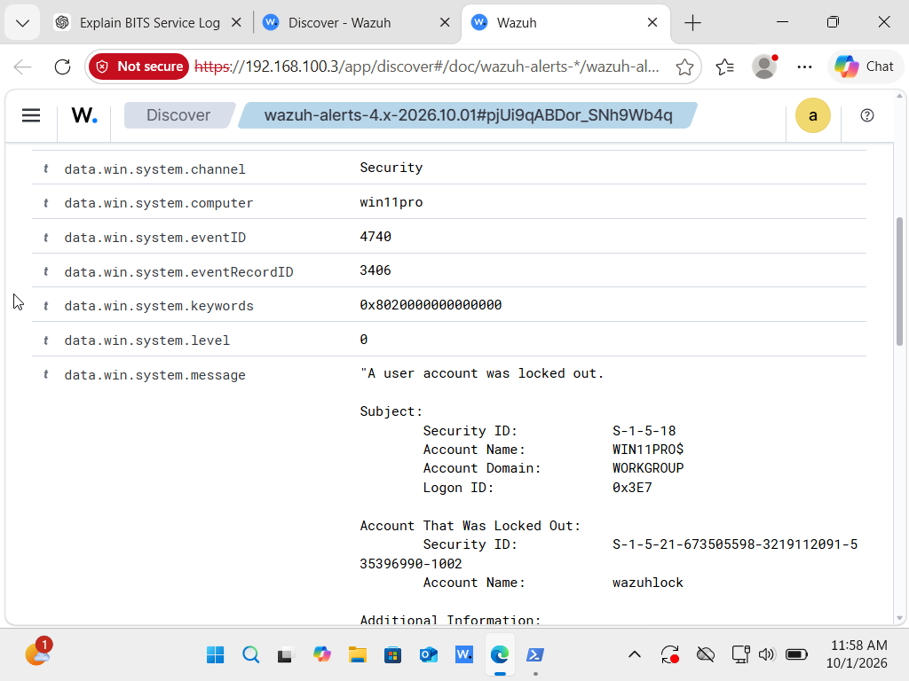

---

### User Creation Alert (Event ID 4720)

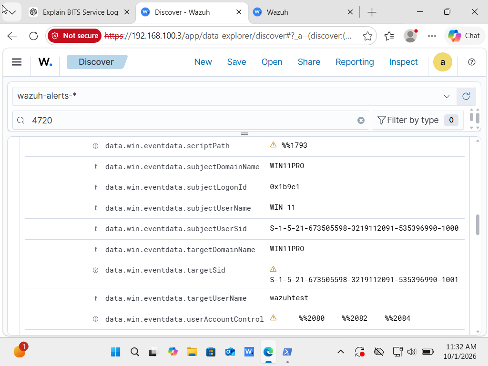

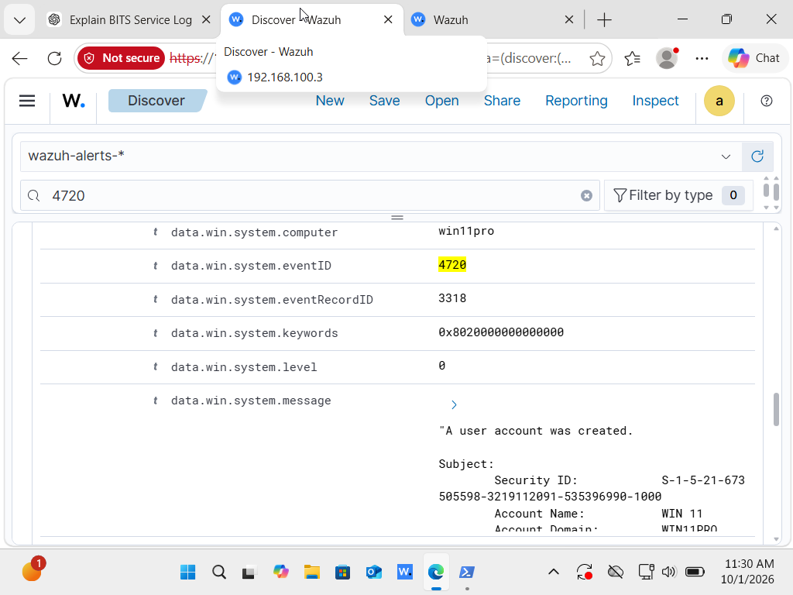

---

### Administrator Group Alert (Event ID 4732)

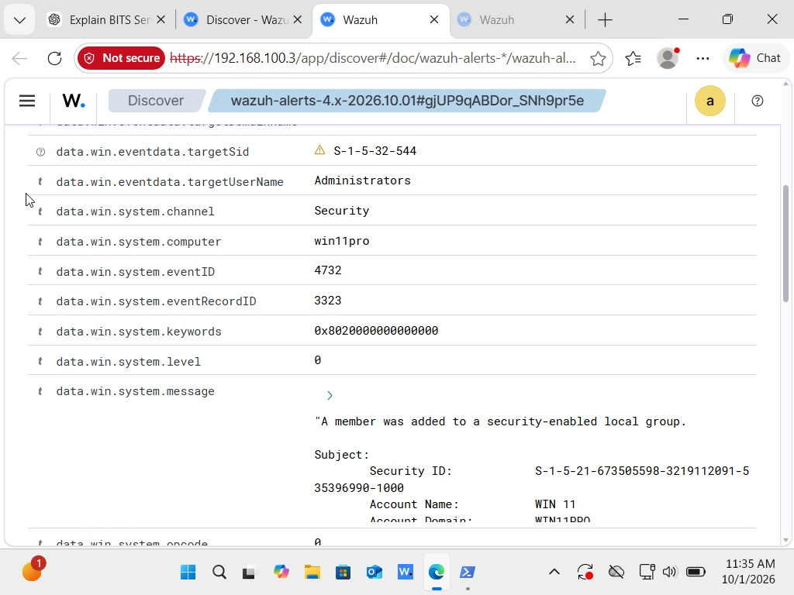

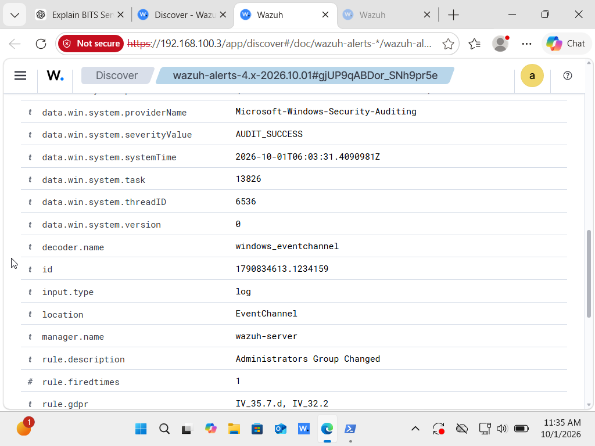

---

### Service Change Alert (Event ID 7040)

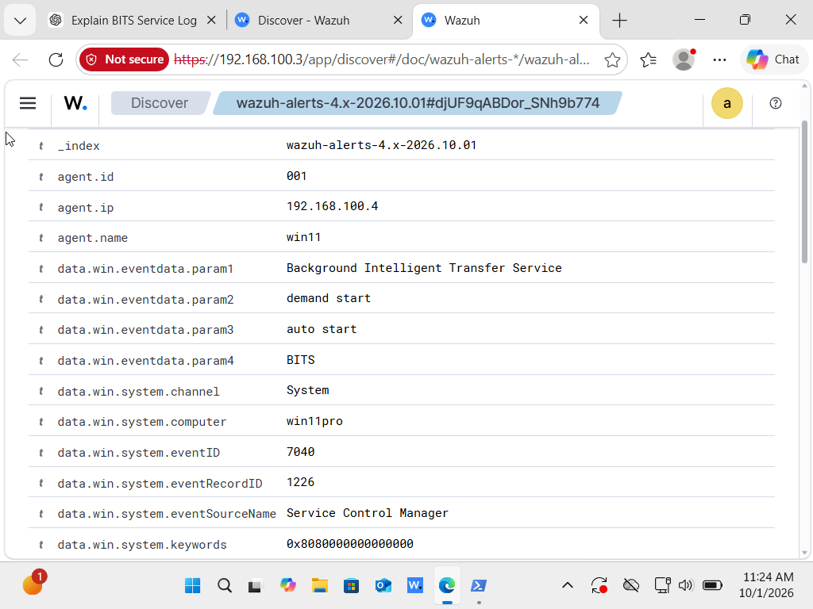

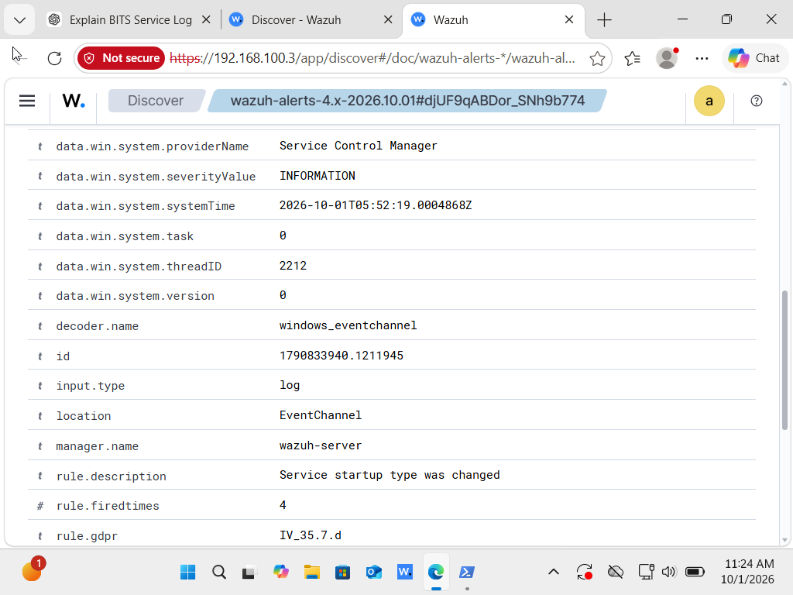

---

### System Restart Alert (Event ID 1074)

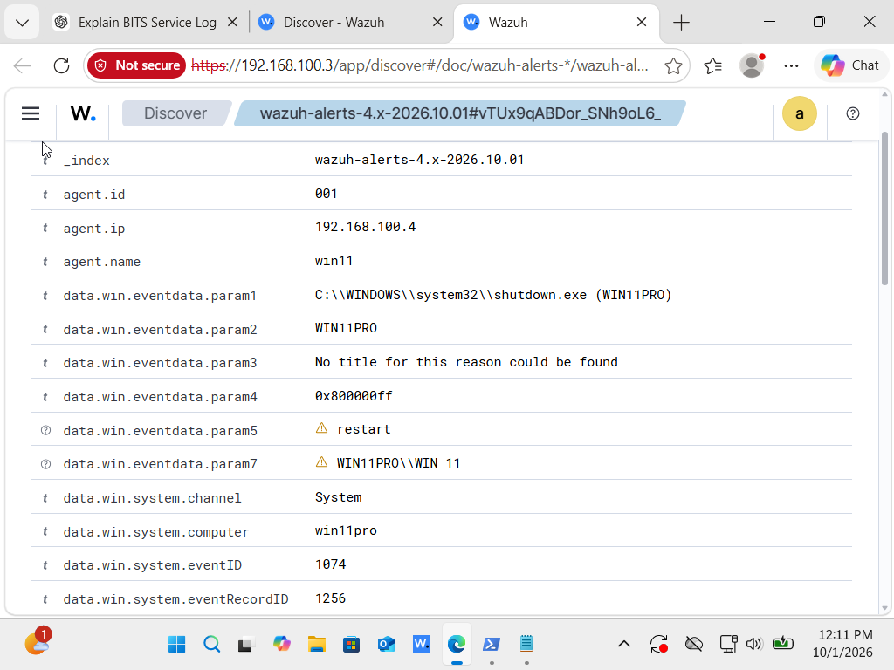

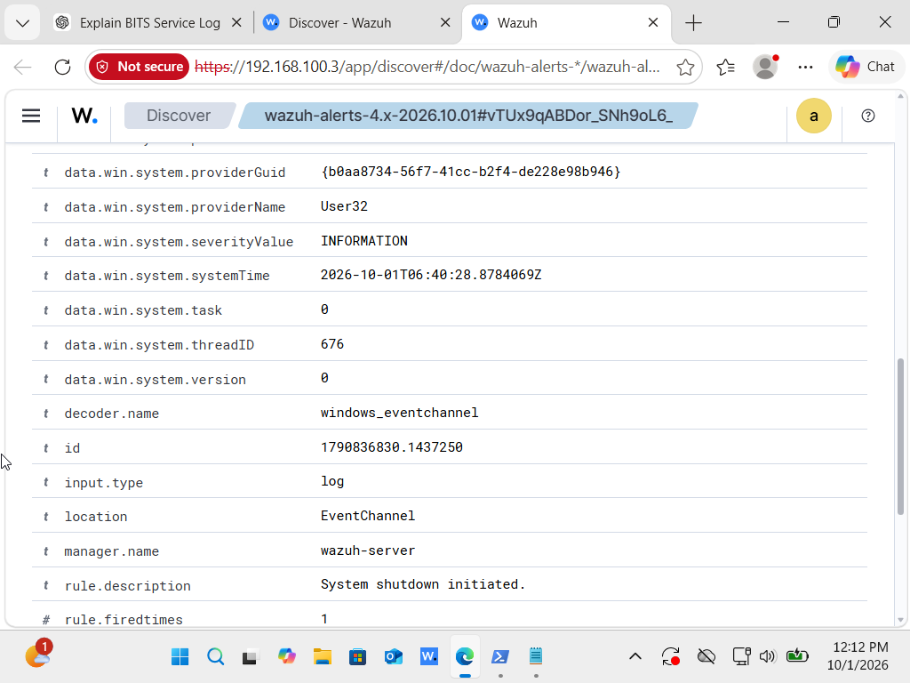

---

## Conclusion

This lab successfully demonstrated Wazuh's capability to collect and analyze Windows security logs. Multiple security events were generated and investigated, providing hands-on experience with alert monitoring, event analysis, and SOC operations. The project highlights how Wazuh can be used to improve visibility into authentication activity, account management, privilege changes, service modifications, and system events within a Windows environment.